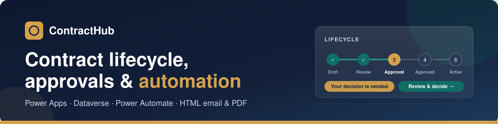
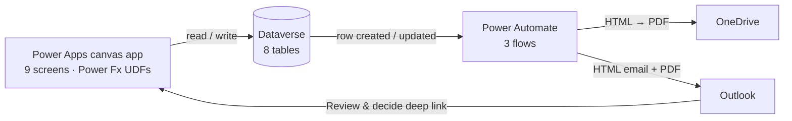

  

  
  
  
  
  

  <b>ContractHub</b> is a contract management solution built end-to-end on <b>Power Apps</b>, <b>Dataverse</b> and
  <b>Power Automate</b>. It takes a contract from draft through review, multi-stage approval, activation and renewal.
  Approvers get modern HTML emails with a generated PDF summary and a one-click link back into the app.

---

## ✨ Highlights

<table>
  <tr>
    <td width="33%" valign="top">
      <h3>🔄 Full lifecycle</h3>
      Draft → In Review → Pending Approval → Approved → Active → Renewed / Expired / Terminated, with a one-click "Move to next stage".
    </td>
    <td width="33%" valign="top">
      <h3>🧭 Approval routes</h3>
      Approvers per stage, with a default route per contract type that any contract can override.
    </td>
    <td width="33%" valign="top">
      <h3>✅ Automated approvals</h3>
      The last approval advances the contract. A rejection sends it back one stage with the approver's comment.
    </td>
  </tr>
  <tr>
    <td width="33%" valign="top">
      <h3>📧 Branded emails</h3>
      Responsive HTML with a lifecycle tracker, approval trail, recent activity and a deep link into the app.
    </td>
    <td width="33%" valign="top">
      <h3>📄 PDF summary</h3>
      Generated on the fly and attached to every email, together with the latest signed contract document.
    </td>
    <td width="33%" valign="top">
      <h3>🕓 History timeline</h3>
      Comments, calls, negotiations, stage changes, decisions, milestones and documents, newest first.
    </td>
  </tr>
</table>

---

## 📊 Dashboard & contracts

A live view of the portfolio: active contract value, contracts expiring in 60 days, overdue milestones,
and contracts by status. The contract list supports search and quick filters.

## 📁 Contract workspace

Each contract opens in a workspace with KPI cards, a **lifecycle stepper** and tabs for **Overview, History,
Milestones, Approvals and Documents**.

| 🕓 History timeline | 🎯 Milestones |
|---|---|
|  |  |

## 🧭 Approval routing

> [!TIP]
> Admins set up a **default approval route** for each contract type, with approvers for
> **In Review**, **Pending Approval** and **Final Sign-off**. Any contract can customise its own route on its Approvals tab.

When a contract enters a stage, the app creates an approval request for each approver on that stage's route.
The assigned approver sees a **"Your decision is needed"** panel and decides in one click.

| ✅ Decision on a contract | 📥 Approvals inbox |
|---|---|
|  |  |

> [!IMPORTANT]
> **The last approval of a stage moves the contract forward automatically.** A **rejection** needs a comment,
> withdraws the other open requests and sends the contract back one stage.

## 📧 Email notifications & PDF

Three Power Automate flows keep everyone informed:

<table>
  <tr><th align="left">Flow</th><th align="left">Trigger</th><th align="left">Recipient</th></tr>
  <tr><td></td><td>An approval is requested for a stage</td><td>👤 Approver</td></tr>
  <tr><td></td><td>An approver approves or rejects</td><td>👤 Contract owner</td></tr>
  <tr><td></td><td>The contract moves to a new stage</td><td>👤 Contract owner</td></tr>
</table>

Every email includes key terms, a lifecycle tracker, the approval trail, recent activity and a
**Review & decide** button that opens the contract directly in the app. The attachments are a generated
**PDF contract summary** and the latest uploaded contract document.

| 📧 Approval email | 📄 Generated PDF summary |
|---|---|
|  |  |

## 🤝 Parties & milestones

| 🏢 Parties | 🎯 Milestones across all contracts |
|---|---|
|  |  |

---

## 🏗️ Architecture

<table>
  <tr>
    <td width="50%" valign="top">
      <h3>🗃️ Data model</h3>
      
      
      
      
      
      
      
      
    </td>
    <td width="50%" valign="top">
      <h3>⚙️ Engineering notes</h3>
      <ul>
        <li>Approval logic lives in Power Fx <b>user-defined functions</b>, shared by every screen</li>
        <li><b>Delegation-safe</b> Dataverse queries, with no delegation warnings</li>
        <li>Email and PDF templates are <b>generated from source</b>, so they're versioned and previewable</li>
        <li>Everything ships in <b>one solution</b>, with environment variables and connection references</li>
      </ul>
    </td>
  </tr>
</table>

---

  <b>Designed and built by Muhammad Bilal</b>, Power Platform developer 
  I build business apps, approval workflows and automations with Power Apps, Dataverse and Power Automate. 
  Get in touch to discuss a similar solution for your team.

