# ContractHub · Contract Lifecycle Management on Microsoft Power Platform

**ContractHub** is a contract management solution built end-to-end on **Power Apps**, **Dataverse** and
**Power Automate**. It takes a contract from draft through review, multi-stage approval, activation and renewal.
Approvers get modern HTML emails with a generated PDF summary and a one-click link back into the app.

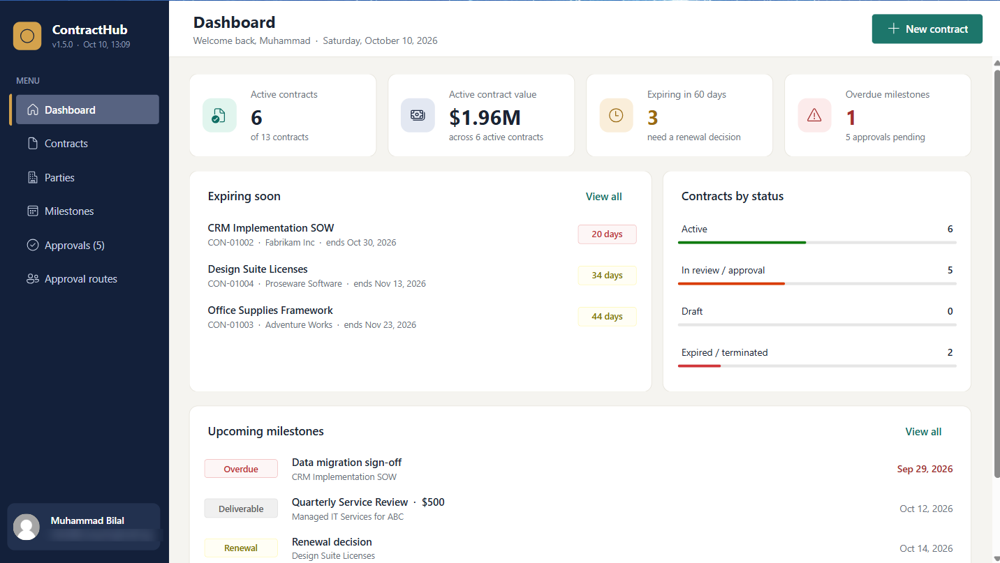

`Power Apps (Canvas)` · `Power Fx` · `Dataverse` · `Power Automate` · `Office 365 Outlook` · `OneDrive (HTML → PDF)` · `Solutions / ALM`

---

## Highlights

- **Full contract lifecycle:** Draft → In Review → Pending Approval → Approved → Active → Renewed / Expired / Terminated
- **Configurable approval routes:** approvers per stage, with a default route per contract type and per-contract overrides
- **Automated approvals:** the last approval advances the contract; a rejection sends it back with the approver's comment
- **Branded email notifications:** responsive HTML with a lifecycle tracker, approval trail, recent activity and deep link
- **Generated PDF summary** attached to every email, plus the latest signed contract document
- **Complete history timeline:** comments, calls, negotiations, stage changes, decisions, milestones and documents
- **Modern UI:** Fluent controls, sidebar navigation, KPI cards, status badges and a lifecycle stepper
- **Solution-aware and ALM-ready:** tables, app, flows, environment variable and connection references in one solution

---

## Dashboard & contracts

A live view of the portfolio: active contract value, contracts expiring in 60 days, overdue milestones,
and contracts by status. The contract list supports search and quick filters.

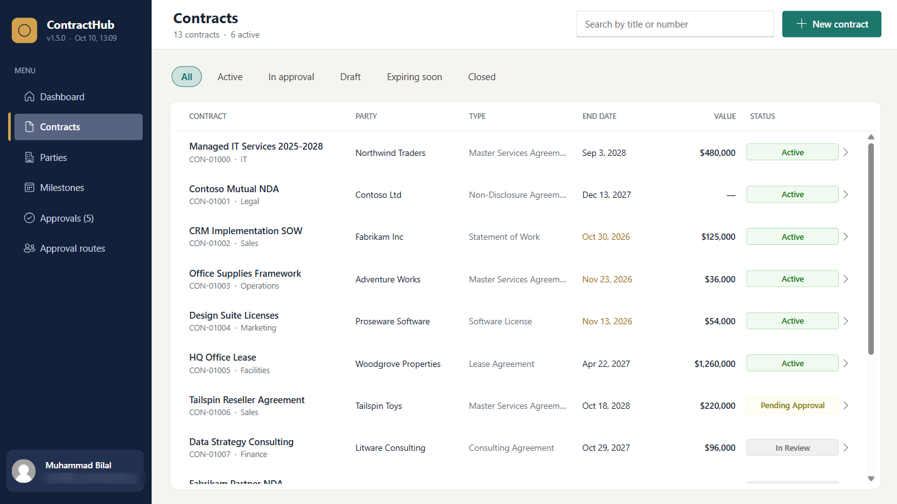

## Contract workspace

Each contract opens in a workspace with KPI cards, a lifecycle stepper and tabs for **Overview, History,
Milestones, Approvals and Documents**. A single button moves the contract to its next stage.

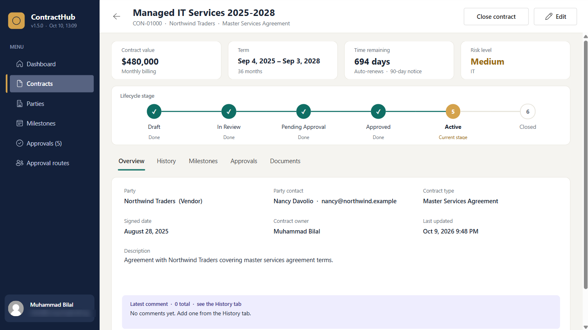

| History timeline | Milestones |
|---|---|
| 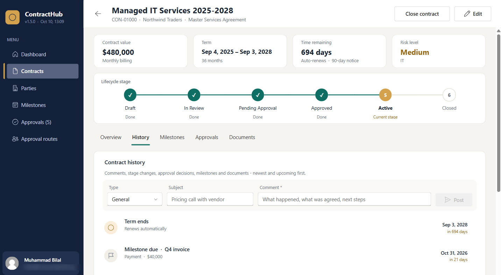 | 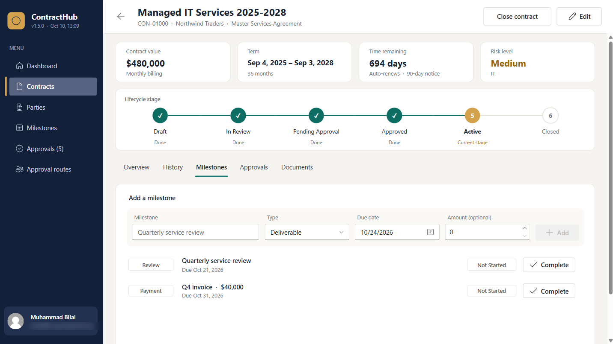 |

## Approval routing

Admins set up a **default approval route** for each contract type, with approvers for *In Review*,
*Pending Approval* and *Final Sign-off*. Any contract can override its route on its Approvals tab.

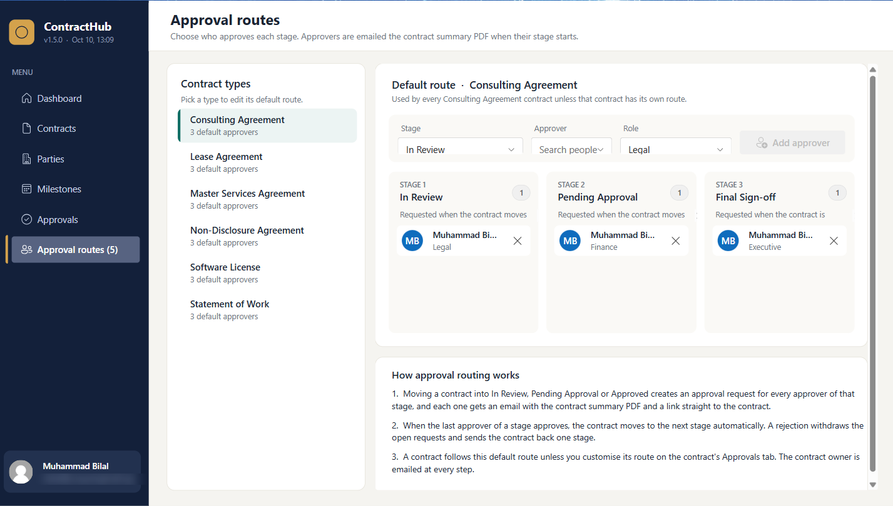

When a contract enters a stage, the app creates an approval request for each approver on that stage's route.
The assigned approver gets a **"Your decision is needed"** panel and decides in one click. A comment is required to reject.

| Decision on a contract | Approvals inbox |
|---|---|
| 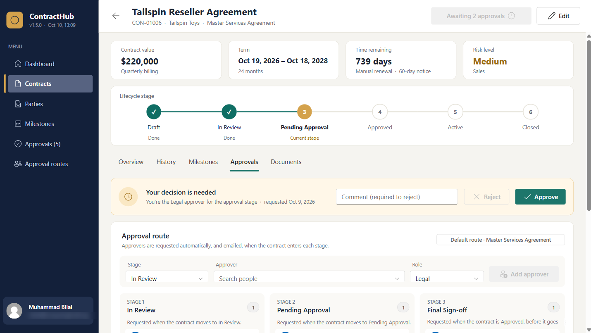 | 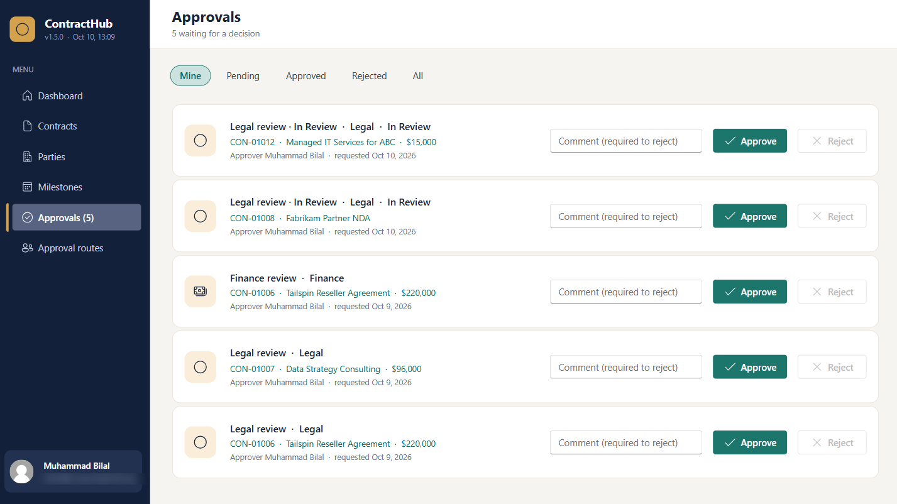 |

## Email notifications & PDF

Three Power Automate flows send email to approvers and contract owners:

| Flow | Trigger | Recipient |
|---|---|---|
| Approval request | Approval requested for a stage | Approver |
| Approval decision | Approved / rejected | Contract owner |
| Status change | Contract moves to a new stage | Contract owner |

Every email includes the contract's key terms, a lifecycle tracker, the approval trail, recent activity and a
**Review & decide** button that opens the contract directly in the app. A **PDF contract summary** is generated
on the fly and attached, together with the latest uploaded contract document.

| Approval email | Generated PDF summary |
|---|---|
| 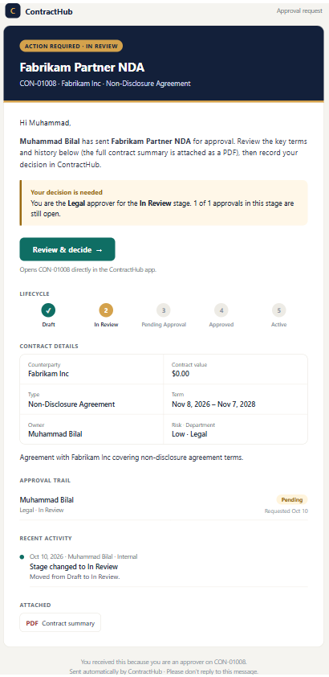 | 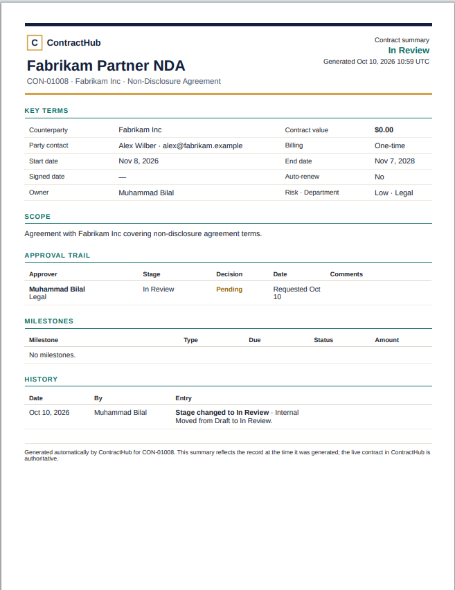 |

## Parties & milestones

| Parties | Milestones across all contracts |
|---|---|
| 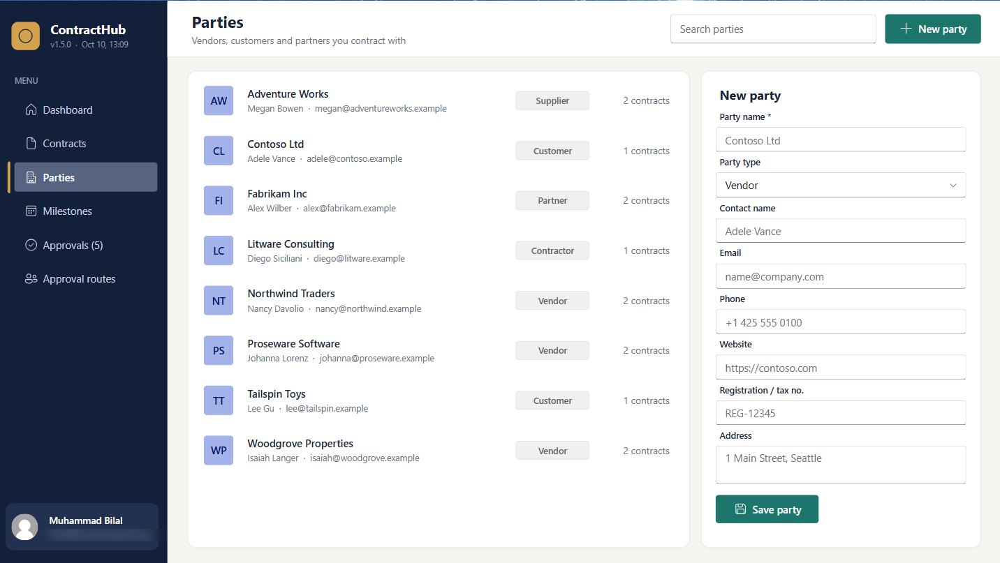 | 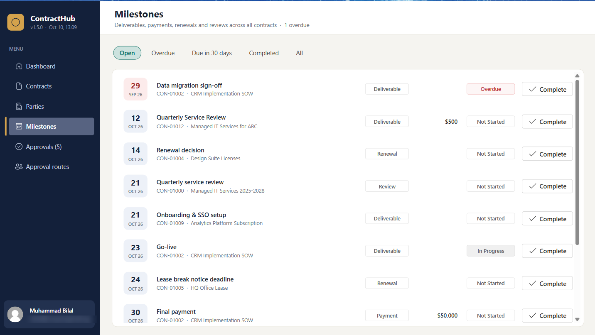 |

---

## Architecture

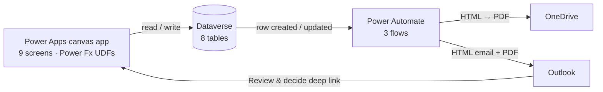

**Data model:** Contract · Party · Contract Type · Milestone · Document · Approval · Comment · Stage Approver

**Engineering notes**
- Approval logic lives in Power Fx **user-defined functions**, shared by every screen that can approve
- Queries are **delegation-safe** for Dataverse, with no delegation warnings
- Email and PDF templates are generated from source, so the design is versioned and previewable
- Environment-specific configuration is kept out of source control, with a pre-commit secret guard

---

## About

Designed and built by **Muhammad Bilal**, Power Platform developer.
I build business apps, approval workflows and automations with Power Apps, Dataverse and Power Automate.
Get in touch to discuss a similar solution for your team.
